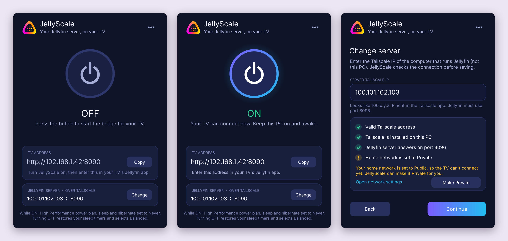
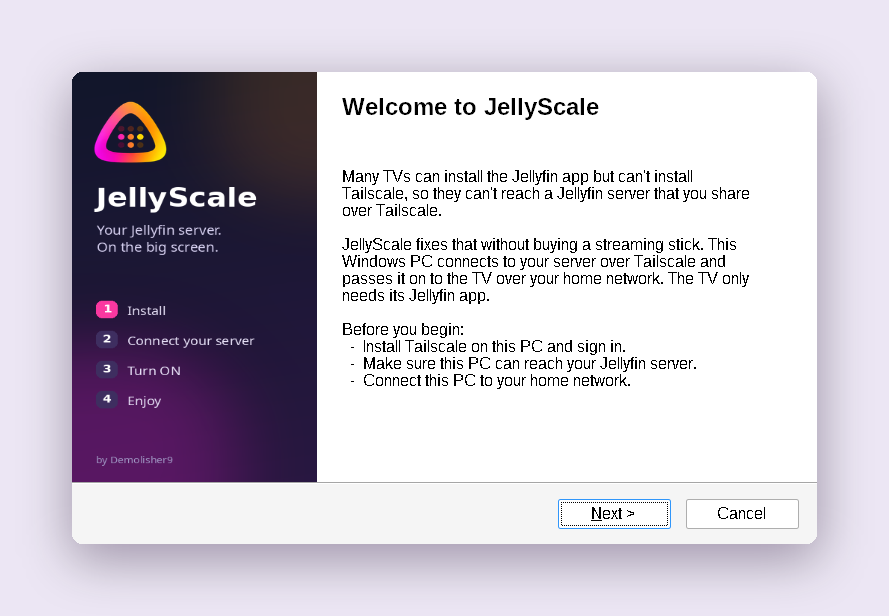
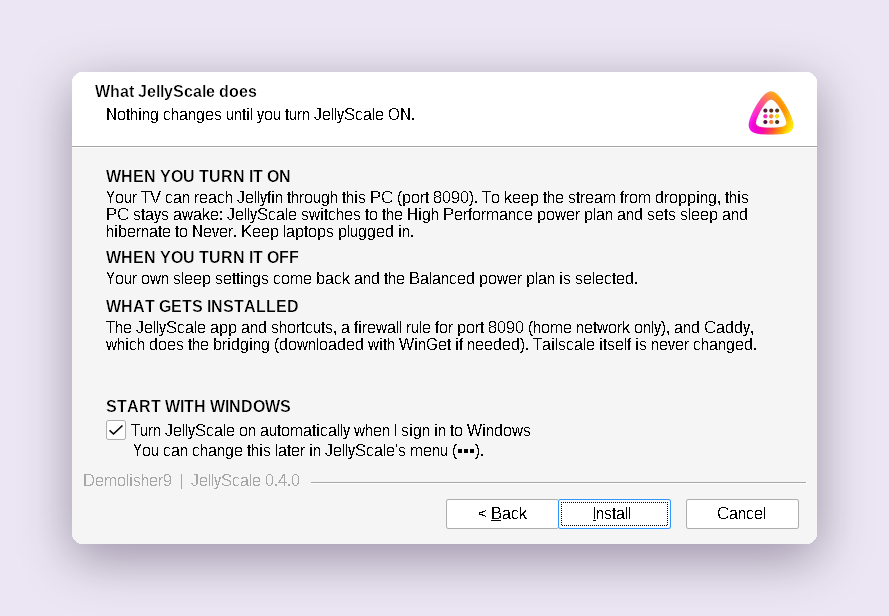
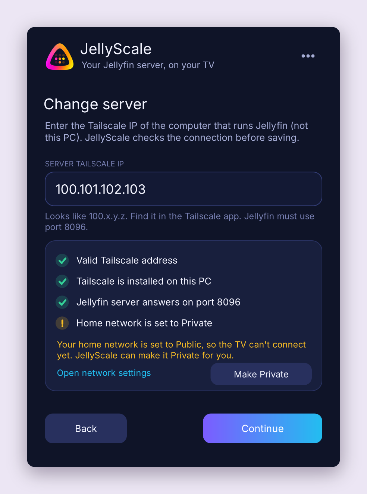
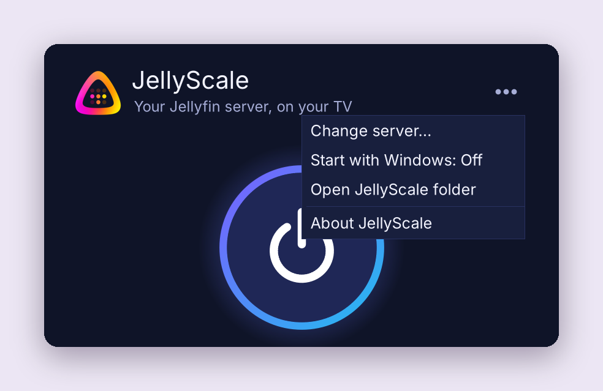

# JellyScale 0.4.0 for Windows

By Demolisher9. An independent helper, not an official Jellyfin or Tailscale product.
JellyScale was previously called **JellyHop**, and before that **Jellyfin TV Bridge**.



**Download:** get `JellyScale-Setup.exe` from the [Releases](../../releases) page.

Many TVs can install the Jellyfin app but can't install Tailscale, so they can't reach a
Jellyfin server that's shared over Tailscale. The usual fix is to buy a streaming
stick. JellyScale is the alternative: any Windows PC on the same home network becomes the
bridge, and the TV only needs its Jellyfin app:

```
TV  --http-->  this PC :8090  (Caddy)  --Tailscale-->  Jellyfin server :8096
```

## Install

Run `JellyScale-Setup.exe` on 64-bit Windows 10 or 11 (it needs .NET Framework 4.8, which
ships with Windows). Install and sign in to Tailscale first. The EXE is unsigned, so
SmartScreen may show "Windows protected your PC": choose More info > Run anyway. (Right-click
the file > Properties > Unblock before running avoids that prompt; Windows 11 with Smart App
Control turned on blocks unsigned apps entirely until the build is code-signed.)

The setup wizard has four pages: Welcome, What JellyScale does, Install, Finish (with
"Open JellyScale now"). It installs:

- `C:\Program Files\JellyScale\JellyScale.exe`, plus Start menu and desktop shortcuts.
- An Installed apps entry (version, size, icon, quiet uninstall).
- Caddy, which does the bridging. Setup copies an existing `caddy.exe` from this PC, or
  downloads the official `CaddyServer.Caddy` package with WinGet (needs internet).
- A firewall rule named JellyScale: inbound TCP 8090, Private networks and LocalSubnet only,
  limited to JellyScale's own `caddy.exe`.

The second page has a **Start with Windows** checkbox (off for new installs; a reinstall keeps
the current setting). Setup itself changes no power or network settings.

**Upgrading from JellyHop:** setup detects it, asks once, then removes it with its own
uninstaller (which turns it off, restores your sleep settings and removes its firewall rule).
Your server address and its `caddy.exe` are kept. If JellyHop can't turn itself off, setup stops
and leaves it in place so nothing is half-removed.

**Upgrading from Jellyfin TV Bridge:** setup detects it, turns it off and removes it with its
own uninstaller, then reuses its server address and `caddy.exe`. The older C:\Caddy version
is still not migrated: remove it first, as before.

**Reinstalling or upgrading JellyScale:** run the new setup. It closes the app and turns the
bridge off first; your server address is kept.

## Using JellyScale

Open JellyScale from the Start menu or desktop and approve the administrator prompt.

1. **Connect your server** (first run only). Enter the server's Tailscale IP (100.x.y.z).
   JellyScale checks that the address is valid, that Tailscale is installed, that Jellyfin
   answers on port 8096, and that your home network is Private. A Public network is a
   warning, not a blocker, because the TV can't connect until it is changed to Private:
   **Make Private** does that after you confirm the network's name (see below), or use
   Open network settings.
2. **Press the big button** to turn the bridge ON. JellyScale shows the TV address
   (`http://PC-LAN-IP:8090`) with a Copy button. Enter it in the TV's Jellyfin app, sign in
   normally and test playback.
3. **Press it again** to turn OFF.

Closing the window while ON keeps the bridge running and puts JellyScale in the
notification area (the tray icon gets a green dot). Click the icon to open it, or right-click
for Turn OFF and Exit. You can change the server from the server card or the ••• menu while
JellyScale is OFF.

### Start with Windows

Turn it on in setup or in the ••• menu (Start with Windows: On/Off). When you sign in to
Windows, JellyScale opens in the notification area and turns the bridge on, so nobody has to
open the app for the TV to work. It waits up to 3 minutes for Tailscale to reach the server
(nothing is changed until it does); if it still can't, the window opens and shows why. If
Windows restarted while the bridge was ON, the saved sleep settings are restored first.

It's a Task Scheduler task named JellyScale, for the user who turned it on, that runs
`JellyScale.exe --autostart` at sign-in with highest privileges (so there's no UAC prompt; the
Run key can't start administrator apps). It needs someone to sign in: it doesn't run at the
Windows sign-in screen. Uninstall removes it.

### Home network type (Make Private)

The firewall rule only allows Private networks, so a Public home network blocks the TV. Make
Private (in the server check list, or the "Fix it" hint while ON) finds the network that carries
the TV address, asks you to confirm it by name, and switches it to Private. Only do this for
your own home network. JellyScale writes down what it changed in `network-changes.json`;
uninstall sets that network back to Public, unless it isn't Private any more (then it's left
alone). Work (domain) networks aren't changed.

### Power behaviour (unchanged from 0.3)

ON saves High Performance's AC and battery sleep/hibernate timers, sets them to Never and
selects High Performance. OFF restores the saved timers and always selects Balanced, even if
you used a different plan before. Display-off timing is unchanged. Lid-close, manual
sleep/shutdown, low-battery actions and enforced policies are not overridden, so keep laptops
plugged in. If High Performance isn't available, JellyScale reports an error and changes
nothing.

### Restarts and crashes

Unless Start with Windows is on, nothing starts automatically. If Windows restarts while
JellyScale is ON, the next time JellyScale opens it notices and restores your sleep settings
(with Start with Windows, it then turns the bridge back on). If Caddy stops while JellyScale is
open (even in the tray), it does the same and tells you.

## Uninstall

Settings > Apps > Installed apps > JellyScale > Uninstall. If JellyScale is ON, it is turned OFF
first (timers restored, Balanced selected). The uninstaller removes the app folder (including
JellyScale's copy of Caddy, settings and logs), the shortcuts, the firewall rule, the Start
with Windows task and the Installed apps entry. If JellyScale made your network Private, it is
set back to Public. Tailscale and any other Caddy installation are left alone. If power
settings can't be restored, you're asked whether to keep JellyScale so you can retry (the
default) or remove it anyway.

## Network and ownership

The remote server uses port 8096; the local bridge listens on 8090. The TV-to-PC hop is plain
HTTP with Jellyfin's normal login; PC-to-server goes over Tailscale. Reserve the PC's LAN IP in
your router so the TV's saved address stays the same. No router ports or VPN routes are set.
Caddy's admin API and config autosave are disabled, and JellyScale only ever stops the Caddy
at its own path.

Files in `C:\Program Files\JellyScale`: `JellyScale.exe`, `caddy.exe`, `Caddyfile` (rewritten at
each ON), `settings.json`, `power-state.json` (only while ON), `network-changes.json` (only
after Make Private), `caddy.log`, `jellyscale.log`, `Uninstall.exe`, `THIRD-PARTY-NOTICES.txt`.

## What changed from JellyHop 0.4.0

- New name, JellyScale, and a new pink-and-orange logo. The installer art uses the new logo.
- The welcome page explains what the app is for, and the second page is reworded.
- Start with Windows (installer checkbox and ••• menu): opens in the tray at sign-in and turns
  the bridge on, waiting for Tailscale if needed.
- Make Private: one click (with confirmation) to set the home network to Private; uninstall
  sets it back to Public.
- Setup upgrades an existing JellyHop install in place (see Install above).
- Everything that carried the old name now says JellyScale: the install folder
  (`C:\Program Files\JellyScale`), shortcuts, Installed apps entry, firewall rule and log file
  (`jellyscale.log`). Bridge and power behaviour are unchanged.

## What changed from Jellyfin TV Bridge 0.3

- New name, icon and installer art.
- The desktop ON/OFF button (an NSIS launcher running PowerShell with message boxes) is now
  a real Windows app with a window, status, TV address with Copy, and a tray icon.
- The four PowerShell scripts were ported to C# inside JellyScale.exe. Power, firewall and
  Caddy behaviour are the same, and PowerShell is no longer used.
- The server address is entered in the app and can be changed later, without reinstalling.
- Installer: Start menu shortcut, in-place upgrades, migration from Jellyfin TV Bridge, and
  a complete Installed apps entry.
- Sleep settings are restored automatically after a restart or crash.
- A failed ON no longer switches you to Balanced if nothing had been changed yet, and
  uninstall only touches the power plan if JellyScale was ON.

## Build from source

```
src/       C# 5 / .NET Framework 4.8 WinForms app
  Program.cs     entry point and installer verbs
  Core.cs        power plan, Caddy, network checks, setup (the old PowerShell logic)
  Backend.cs     app actions + a demo backend for UI previews
  MainForm.cs    the window and tray icon
  Controls.cs    theme and custom controls
res/       app.manifest (administrator, DPI aware), JellyScale.rc, prebuilt JellyScale.res
art/       JellyScale.ico, JellyScale-128.png, wizard.bmp, all made from source/JellyScale-logo.ico
           (regenerate after changing the logo: python3 tools/make_art.py)
Setup.nsi  installer and uninstaller (NSIS 3, Modern UI 2)
tools/     build.cmd (Windows), build.sh (Linux), make_art.py
docs/      screenshots for this README
```

**Windows:** install NSIS 3, then run `tools\build.cmd`. It uses the C# compiler that comes
with Windows, so no Visual Studio is needed.

**Linux:** install `mono-devel`, `binutils-mingw-w64-x86-64` and `nsis`, then run
`tools/build.sh`.

Both produce `build\JellyScale.exe` and `JellyScale-Setup.exe`. JellyScale.exe also accepts these
command-line options, which the installer uses:

```
JellyScale.exe --setup [--import <dir>] [--autostart on|off]
                                          get Caddy, add the firewall rule, import old settings,
                                          set Start with Windows
JellyScale.exe --stop                     close the window; turn the bridge OFF if it's on
JellyScale.exe --uninstall                --stop, then remove the firewall rule and Start with
                                          Windows, and undo Make Private
JellyScale.exe --autostart                (used by Start with Windows) open in the tray, turn ON
JellyScale.exe --demo[-on|-off|-error|-public|-interrupted|-autostart]   preview the UI; changes nothing
```

## Validation and Windows acceptance checklist

Built on Linux with mcs (C# 5 against .NET 4.8 reference assemblies) and NSIS 3.09 with
warnings treated as errors. Every app screen was exercised in demo mode under Mono. Logic
tests covered IP validation, settings (including the old PowerShell JSON), legacy import,
Caddyfile output (identical to 0.3), powercfg parsing, the power backup round trip and
socket checks. Win64 P/Invoke struct sizes were verified. The installer and uninstaller were
run under Wine: all pages, the legacy and upgrade prompts, the failure paths and uninstall
cleanup.

For the JellyScale rename, the app was rebuilt the same way, both demo screens were checked
under Mono, and the upgrade from JellyHop was run under Wine with stand-ins for the .NET app:
a normal upgrade (server address and Caddy handed over; JellyHop's folder, shortcuts and entry
removed), JellyHop failing to turn off (setup stops, JellyHop left intact), a leftover JellyHop
entry with no folder, and JellyScale's own uninstaller.

Start with Windows and Make Private were exercised under Mono with the demo backend and a
test driver: starting hidden in the tray, waiting through an unreachable server, turning ON
with a notification, the menu toggle and its confirmation, and Make Private from the check list
and from the main window. The installer pages were checked under Wine at 100% and 150%
scaling (including the longest JellyHop variant), and the upgrade test was repeated to confirm
`--autostart on|off` is passed. The Windows-only parts (Task Scheduler, the network type
change through WMI or Network List Manager) can't run there and need the checks below.

JellyScale has been tested on real Windows by the author. If you hit a problem, please open an Issue. The checklist below covers the main things verified:

- Cancel setup before installing: no app, firewall or power changes.
- Install with no Caddy on the PC (WinGet download) and with Caddy already on PATH.
- Upgrade over JellyHop 0.4.0, once while it's OFF and once while it's ON: sleep settings
  restored, server address kept, and JellyHop's folder, shortcuts, firewall rule and Installed
  apps entry are gone.
- Upgrade over Jellyfin TV Bridge 0.3: the server address is kept and the old entry is gone.
- Wrong IP or unreachable server: the check list shows the failure and nothing is saved.
- ON: compare the saved High Performance timers; confirm Never on AC and battery.
- Play a movie on the TV, then OFF: original timers, Balanced active, port 8090 closed.
- Close the window while ON: tray icon with a green dot; the TV keeps playing.
- Kill caddy.exe while ON: JellyScale turns OFF and restores the timers within about 5 seconds.
- Restart Windows while ON, then open JellyScale: the timers are restored.
- Occupy port 8090 before ON: clear error, no power change.
- Run another Caddy elsewhere: JellyScale must not stop it.
- Uninstall while ON: timers restored; app, rule and shortcuts removed; Tailscale kept.
- Start with Windows: tick it in setup, sign out and in: the tray icon appears and turns ON
  with a notification, with no UAC prompt. Check the task in Task Scheduler (no time limit,
  normal priority). Restart while ON: sleep settings restored, then ON again. Untick it in the
  ••• menu: the task is gone.
- Start with Windows with Tailscale slow to connect (or the server off): waits, then turns ON;
  with the server off for over 3 minutes, the window opens with the error.
- Make Private on a Public home network: confirm shows the right network name; the check turns
  green; the TV connects. Uninstall: that network is Public again. Set it Public yourself
  first, then uninstall: nothing changes.
- UI at 100%, 150% and 200% scaling, and Windows with Swedish display language.

## More screenshots

| Installer | Start with Windows |
|---|---|
|  |  |
|  |  |

## License

See [LICENSE](LICENSE). Third-party notices are in THIRD-PARTY-NOTICES.txt.
